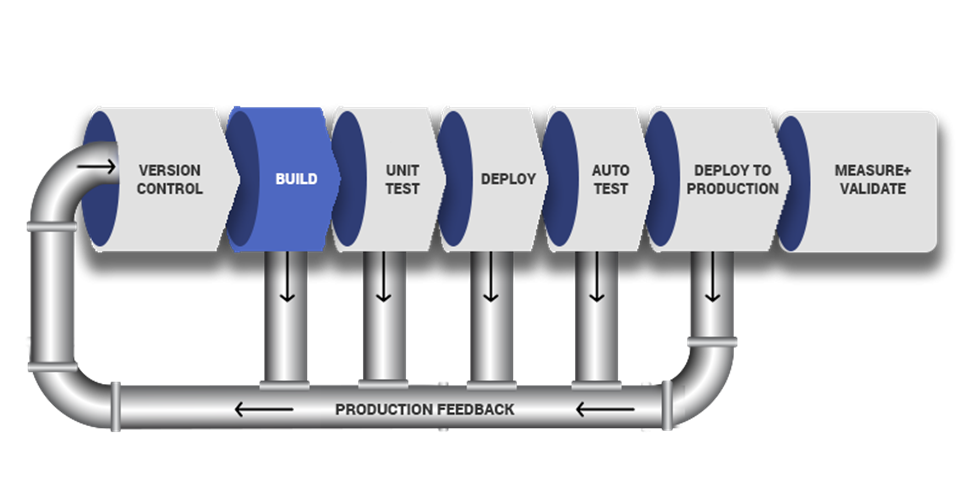
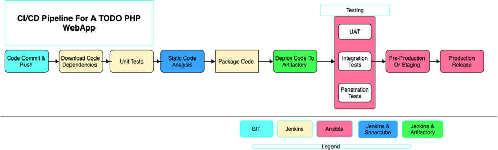
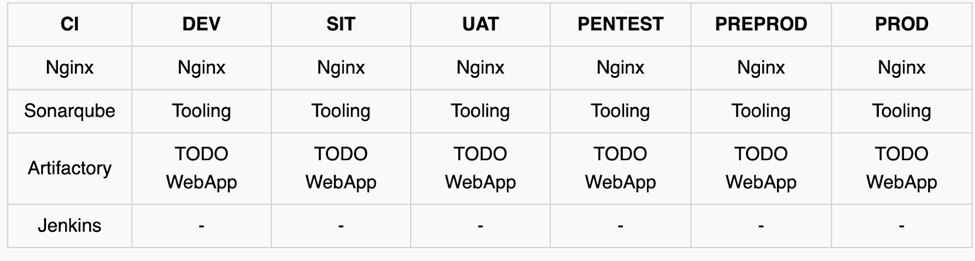
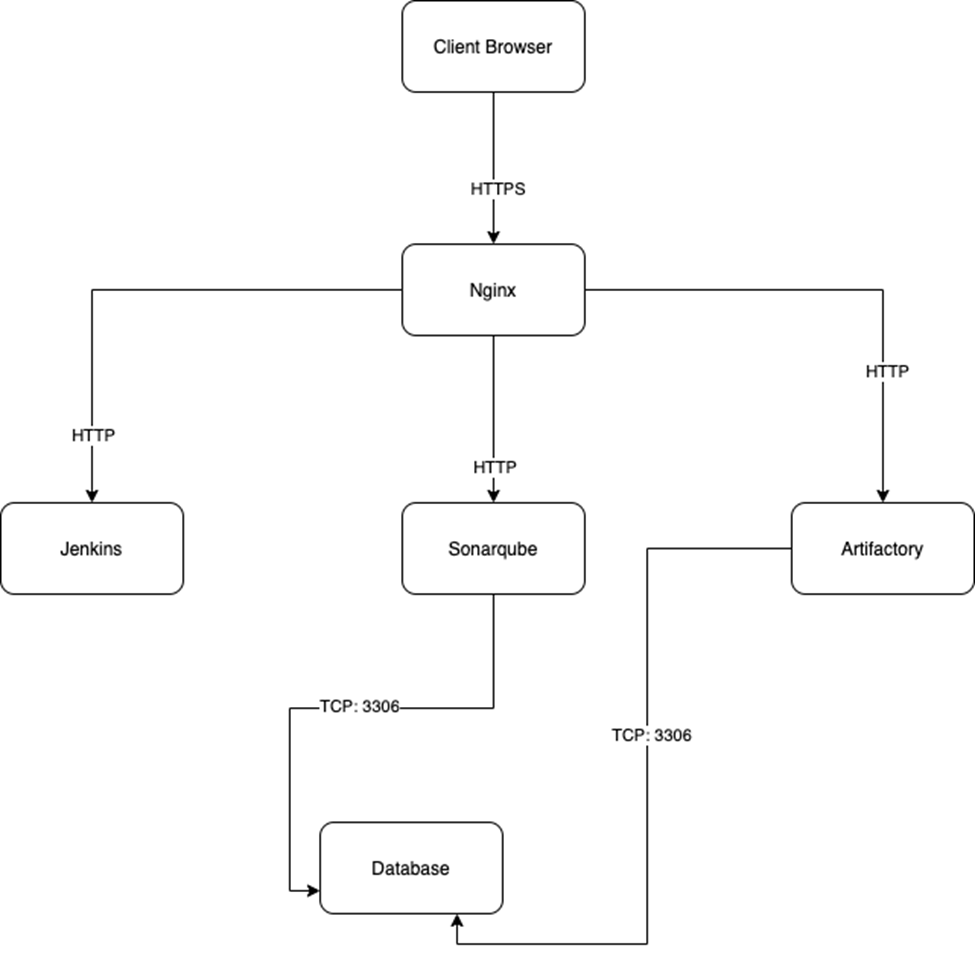
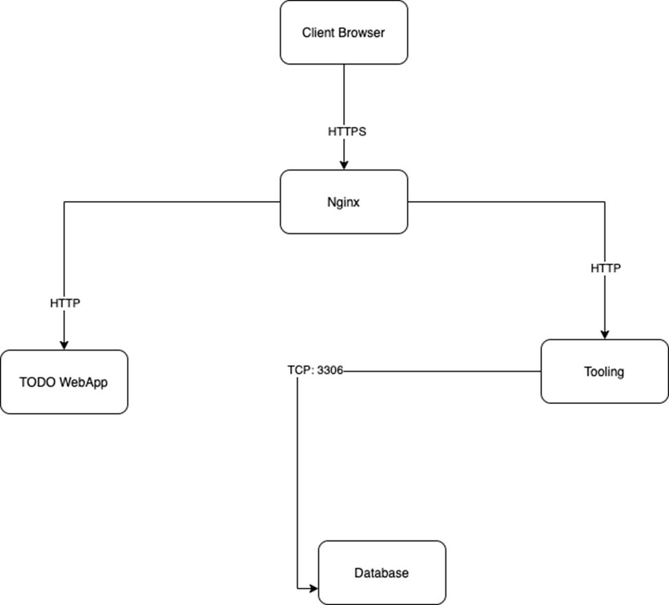

<!-- PROJECT LOGO -->
<br />
<div align="center">
  <a href="https://github.com/Adewalesemiloore/DevopsTask">
    
  </a>

<h3 align="center">EXPERIENCE CONTINUOUS INTEGRATION WITH JENKINS | ANSIBLE | ARTIFACTORY | SONARQUBE | PHP</h3>
  <p><b style="color: #fb6900">Maintainer:</b> <kbd>Adewale Oluwasemiloore</kbd> &nbsp; <b style="color: #fb6900">Date:</b> <kbd>November 26, 2026</kbd></p>
</div>

<p align="center">
  
  
  
  
  
  
  
  
  
  
  
  
</p>

---

## Project Overview

Until now I deployed the Tooling website by pulling code straight from Git into `/var/www/html`. It works, but it is not how real software is shipped. Compiled languages (Java, .NET) need a **build** step that produces an executable such as a `.jar`. Interpreted languages such as PHP, JavaScript or Python do not, which is why Git-to-webroot worked so easily. Even so, downloading raw code from Git onto servers makes it hard to **package** and **version** releases. A better way is to bundle the code and its dependencies into an archive (for example a `.zip`), store it in an artifact repository, and unpack it on the target environment.

In this project I build a pipeline that simulates a real **CI/CD** process for a PHP application (the TODO app), using:

- **Jenkins** as the CI server and pipeline engine
- **Ansible** to deploy and configure the servers, triggered from Jenkins
- **Artifactory** to store versioned build artifacts
- **SonarQube** to analyse code quality and enforce quality gates

### CI/CD in a Nutshell

- **Continuous Integration (CI)** means merging every developer's work into a shared mainline several times a day ("commit early, push often"). Small frequent merges avoid "merge hell", and every merge is built and tested automatically.
- **Continuous Delivery** means the mainline is always ready to deploy, with a human pressing the button after QA passes. **Continuous Deployment** removes that human step entirely.
- A typical CI workflow: run unit tests locally, push, let the CI server build and run tests and static analysis, publish the artifact, then deploy it through test environments (SIT, UAT, pentest) towards production.



The target pipeline for this project:



### Why Track Metrics?

DevOps is about shipping quality code quickly without breaking things, so I keep these measures in mind: deployment frequency, lead time, customer tickets, percentage of passed automated tests, defect escape rate, availability, SLA compliance, failed deployments, error rates, application usage and traffic, application performance, mean time to detection (MTTD) and mean time to recovery (MTTR).

---

## Table of Contents

- [Architecture Overview](#architecture-overview)
- [Part 1 — Configure the Jenkins Server](#part-1--configure-the-jenkins-server)
- [Part 2 — Build a Jenkins Pipeline with Blue Ocean](#part-2--build-a-jenkins-pipeline-with-blue-ocean)
- [Part 3 — Run Ansible from Jenkins](#part-3--run-ansible-from-jenkins)
- [Part 4 — Parameterise the Deployment](#part-4--parameterise-the-deployment)
- [Part 5 — CI/CD Pipeline for the TODO Application](#part-5--cicd-pipeline-for-the-todo-application)
- [Part 6 — SonarQube Installation](#part-6--sonarqube-installation)
- [Part 7 — SonarQube Quality Gate in Jenkins](#part-7--sonarqube-quality-gate-in-jenkins)
- [Part 8 — Conditional Deployment to Higher Environments](#part-8--conditional-deployment-to-higher-environments)
- [Part 9 — Jenkins Agents](#part-9--jenkins-agents)
- [Errors & Fixes](#errors--fixes)

---

## Architecture Overview

Both the Tooling and TODO applications are PHP, so they can be deployed without compiling. Nginx acts as a reverse proxy in front of sites and tools. Servers are only created for the environment I am working on at the moment. To start with: **CI**, **Dev** and **Pentest**.



The CI environment (Jenkins, Nginx, SonarQube, Artifactory):



The other environments from lower to higher:



The Ansible inventory has one file per environment:

```
├── ci
├── dev
├── pentest
├── pre-prod
├── prod
├── sit
└── uat
```

`ci`:

```ini
[jenkins]
<Jenkins-Private-IP-Address>

[nginx]
<Nginx-Private-IP-Address>

[sonarqube]
<SonarQube-Private-IP-Address>

[artifact_repository]
<Artifact-Repository-Private-IP-Address>
```

`dev`:

```ini
[tooling]
<Tooling-Web-Server-Private-IP-Address>

[todo]
<Todo-Web-Server-Private-IP-Address>

[nginx]
<Nginx-Private-IP-Address>

[db:vars]
ansible_user=ec2-user

[db]
<DB-Server-Private-IP-Address>
```

`pentest`:

```ini
[pentest:children]
pentest-todo
pentest-tooling

[pentest-todo]
<Pentest-for-Todo-Private-IP-Address>

[pentest-tooling]
<Pentest-for-Tooling-Private-IP-Address>
```

> **Observations:** `pentest:children` creates a parent group, so Ansible can run against both pentest servers at once while I can still target each child group individually. The `db` group is Red Hat/CentOS (user `ec2-user`) while the rest are Ubuntu, so the connection user differs. Variables shared by a group can be set once with `group_vars`.

Two roles are added for the CI environment: **SonarQube** (static analysis and quality gates: bugs, code smells, security vulnerabilities) and **Artifactory** (a repository for versioned build artifacts).

---

## Part 1 — Configure the Jenkins Server

### 1.0 — Install Jenkins

I installed Jenkins with its dependencies by following the official Jenkins documentation for Linux.


### 2.0 — Update the Bash Profile

So that the Java path is exported every time the machine restarts:

```bash
sudo -i
nano .bash_profile
```

```bash
export JAVA_HOME=$(dirname $(dirname $(readlink $(readlink $(which java)))))
export PATH=$PATH:$JAVA_HOME/bin
export CLASSPATH=.:$JAVA_HOME/jre/lib:$JAVA_HOME/lib:$JAVA_HOME/lib/tools.jar
```

```bash
source ~/.bash_profile
```

### 3.0 — Start Jenkins and Clone the Repo

```bash
sudo systemctl start jenkins
sudo systemctl enable jenkins
sudo systemctl status jenkins
```


I also installed `git` and cloned my `ansible-config-mgt` repository onto the Jenkins server.


---

## Part 2 — Build a Jenkins Pipeline with Blue Ocean

Until now I launched Ansible by hand from the CLI. From here Jenkins runs it.

### 4.0 — Install Blue Ocean and Create a Pipeline

I opened the Jenkins URL:


then installed and opened the **Blue Ocean** plugin:


I created a new pipeline and selected **GitHub** as the source.


There is no `Jenkinsfile` in the repository yet, so Blue Ocean offers to help create one. I do not need that, because I am writing my own. I left Blue Ocean through **Administration**.


### 5.0 — Create the First Jenkinsfile

In the Ansible project I created a `deploy` directory with a `Jenkinsfile` inside. It starts with a single `Build` stage that only echoes a message:

```groovy
pipeline {
    agent any

  stages {
    stage('Build') {
      steps {
        script {
          sh 'echo "Building Stage"'
        }
      }
    }
    }
}
```


In the Ansible pipeline's **Configure** page, under **Build Configuration**, I set the script path to `deploy/Jenkinsfile`.


That triggers a build, and the console output shows the effect of my basic Jenkinsfile.


The same run in Blue Ocean:


### 6.0 — Add More Stages on a Feature Branch

I created a branch `feature/jenkinspipeline-stages` and added a `Test` stage:

```groovy
pipeline {
    agent any

  stages {
    stage('Build') {
      steps {
        script {
          sh 'echo "Building Stage"'
        }
      }
    }

    stage('Test') {
      steps {
        script {
          sh 'echo "Testing Stage"'
        }
      }
    }
    }
}
```


For the new branch to appear in Jenkins, the repository must be scanned.


Blue Ocean now shows a new build for the branch.


I then added more echo stages to simulate the remaining phases: **Package**, **Deploy** and **Clean up**.


After checking in Blue Ocean that every stage ran, I merged the feature branch into `main`.


The `main` branch now has a successful pipeline.


---

## Part 3 — Run Ansible from Jenkins

### 7.0 — Install Ansible on the Jenkins Server

My Jenkins server runs Ubuntu, so the package manager is `apt` rather than the RHEL one:

```bash
sudo apt update && \
sudo apt install ansible -y && \
sudo apt install python3-pip -y && \
python3 -m pip install --upgrade pip setuptools && \
python3 -m pip install pyMySQL mysql-connector-python psycopg2-binary
```


The pip step refused to install system-wide with an `externally-managed-environment` error:


Retrying with `--break-system-packages` worked (see [Errors & Fixes](#errors--fixes)):

```bash
sudo python3 -m pip install --break-system-packages PyMySQL mysql-connector-python psycopg2-binary
```


### 8.0 — Install the Ansible Plugin

In the Jenkins UI I installed the **Ansible** plugin.


### 9.0 — Add Credentials

Jenkins needs the SSH private key so it can reach the target servers. Under **Manage Jenkins → Credentials → System → Global**, I added an **SSH Username with private key** credential with the target server username (`ec2-user`) and my private key.


> **Note:** The credential ID is free text. Whatever ID I choose has to be the one referenced in the Jenkinsfile (`credentialsId`).

### 10.0 — Configure Ansible in Jenkins Tools

Under **Manage Jenkins → Tools** I registered an Ansible installation. To get the executable path I ran `which ansible` on the server and pasted the directory into the tool configuration.


### 11.0 — Generate the Playbook Step with Pipeline Syntax

Instead of guessing the `ansiblePlaybook` syntax, I generated it with the **Pipeline Syntax** snippet generator from the Ansible pipeline's page.


### 12.0 — Rewrite the Jenkinsfile to Run Ansible

I replaced the Jenkinsfile with one that cleans the workspace, checks out the code, prepares the Ansible config and runs the playbook:

```groovy
pipeline {
  agent any

  environment {
      ANSIBLE_CONFIG="${WORKSPACE}/deploy/ansible.cfg"
    }

  parameters {
      string(name: 'inventory', defaultValue: 'dev',  description: 'This is the inventory file for the environment to deploy configuration')
    }

  stages{
      stage("Initial cleanup") {
          steps {
            dir("${WORKSPACE}") {
              deleteDir()
            }
          }
        }

      stage('Checkout SCM') {
         steps{
            git branch: 'main', url: 'https://github.com/<your-github-username>/ansible-config-mgt.git'
         }
       }

      stage('Prepare Ansible For Execution') {
        steps {
          sh 'echo ${WORKSPACE}'
          sh 'sed -i "3 a roles_path=${WORKSPACE}/roles" ${WORKSPACE}/deploy/ansible.cfg'
        }
     }

      stage('Run Ansible playbook') {
        steps {
           ansiblePlaybook become: true, colorized: true, credentialsId: 'ansible-ssh-key', disableHostKeyChecking: true, installation: 'ansible', inventory: 'inventory/dev', playbook: 'playbooks/site.yml'
         }
      }
      stage('Clean Workspace after build'){
        steps{
          cleanWs(cleanWhenAborted: true, cleanWhenFailure: true, cleanWhenNotBuilt: true, cleanWhenUnstable: true, deleteDirs: true)
        }
      }
    }
  }
```

and created `deploy/ansible.cfg` next to it:

```ini
[defaults]
timeout = 160
callback_whitelist = profile_tasks
log_path=~/ansible.log
host_key_checking = False
gathering = smart
ansible_python_interpreter=/usr/bin/python3
allow_world_readable_tmpfiles=true


[ssh_connection]
ssh_args = -o ControlMaster=auto -o ControlPersist=30m -o ControlPath=/tmp/ansible-ssh-%h-%p-%r -o ServerAliveInterval=60 -o ServerAliveCountMax=60 -o ForwardAgent=yes
```

A few things to watch for when running Ansible through Jenkins:

- **Branch name:** the `git` step must check out `main`, not `master`.
- **`ANSIBLE_CONFIG`:** Jenkins has to export it so Ansible finds the config file. Keeping `ansible.cfg` beside the Jenkinsfile in `deploy/` makes it obvious what belongs to deployment.
- **`roles_path`:** it must be handled dynamically if the pipeline runs from different branches. I used `sed` to insert it into `ansible.cfg` each run.
- **Stale workspace:** always start the Jenkinsfile with a cleanup step so a fix I pushed is the code that actually runs.
- **Wrong branch checked out:** if the job runs from another branch but the Jenkinsfile checks out `main`, confirm the branch in the workspace with `git branch`.

I ran a build and confirmed the playbook executed.


---

## Part 4 — Parameterise the Deployment

To deploy to other environments I did not want to edit the Jenkinsfile each time, nor keep one branch per environment. The answer is a **parameter**.

### 13.0 — Update the SIT Inventory

```ini
[tooling]
<SIT-Tooling-Web-Server-Private-IP-Address>

[todo]
<SIT-Todo-Web-Server-Private-IP-Address>

[nginx]
<SIT-Nginx-Private-IP-Address>

[db:vars]
ansible_user=ec2-user

[db]
<SIT-DB-Server-Private-IP-Address>
```

### 14.0 — Add the Parameter

The `inventory` parameter has a default and a description so everybody knows what it is for:

```groovy
pipeline {
    agent any

    parameters {
      string(name: 'inventory', defaultValue: 'dev',  description: 'This is the inventory file for the environment to deploy configuration')
    }
}
```

In the Ansible execution step I replaced the hardcoded `inventory/dev` with the parameter value, so each build asks for the environment:

```groovy
inventory: "inventory/${params.inventory}"
```

### 15.0 — Build with Parameters


My first parameterised build failed. The console showed that Ansible could not find the roles path and the config.


I checked the repository on the server:


and created an `ansible.cfg` at the repository root:


The next build succeeded.


---

## Part 5 — CI/CD Pipeline for the TODO Application

### Phase 1 — Prepare Jenkins

1. I **forked** the `php-todo` repository into my GitHub account.
2. On the Jenkins server I installed PHP, its dependencies and Composer. I did it manually first and can move it into Ansible afterwards.

```bash
sudo apt update
sudo apt install -y php-common php-mbstring php-opcache php-intl php-xml php-gd php-curl php-mysql php-fpm
sudo systemctl start php8.3-fpm
sudo systemctl enable php8.3-fpm
```


Composer:

```bash
sudo apt install -y curl php-cli php-mbstring unzip

curl -sS https://getcomposer.org/installer | php
sudo mv composer.phar /usr/local/bin/composer
```


PHPUnit and phploc:

```bash
sudo apt install -y wget php-cli php-mbstring php-xml php-zip unzip

# Install PHPUnit
wget -O phpunit https://phar.phpunit.de/phpunit-9.phar
chmod +x phpunit
sudo mv phpunit /usr/local/bin/phpunit

# Install phploc
wget -O phploc.phar https://phar.phpunit.de/phploc.phar
chmod +x phploc.phar
sudo mv phploc.phar /usr/local/bin/phploc

# Verify both
phpunit --version
phploc --version
```


3. I installed two Jenkins plugins: **Plot** (to chart test and code metrics) and **Artifactory** (to upload artifacts to an Artifactory server).
4. I ran the build against the `ci` inventory so Ansible set up the Artifactory server.
5. Artifactory listens on port **8081** (and 8082 for the UI). Both ports must be open in the inbound rules. I logged in with the default administrator credentials, changed the password straight away, and created a **generic local repository**.


6. In the Jenkins UI I configured the Artifactory server (instance ID, platform URL and deployer credentials) and used **Test Connection** before saving.


### Phase 2 — Integrate Artifactory with Jenkins

1. I created a dummy `Jenkinsfile` in the `php-todo` repository.
2. Using Blue Ocean I created a **multibranch** pipeline for it.
3. I edited the MySQL role defaults (`roles/mysql/defaults/main.yml`) to create the `homestead` database and a `homestead` user whose host is the **Jenkins server's IP**, so Jenkins can connect remotely:

```yaml
mysql_databases:
  - name: homestead
    collation: utf8_general_ci
    encoding: utf8
    replicate: 1

mysql_users:
  - name: homestead
    host: "<Jenkins-Private-IP>"
    password: <db-password>
    priv: "*.*:ALL"
```


4. I updated the database connection settings in `.env.sample`:

```bash
DB_CONNECTION=mysql
DB_HOST=<DB-Server-Private-IP>
DB_PORT=3306
DB_DATABASE=homestead
DB_USERNAME=homestead
DB_PASSWORD=<db-password>
```


5. I wrote the first working pipeline for `php-todo`:

```groovy
pipeline {
    agent any

  stages {

     stage("Initial cleanup") {
          steps {
            dir("${WORKSPACE}") {
              deleteDir()
            }
          }
        }

    stage('Checkout SCM') {
      steps {
            git branch: 'main', url: 'https://github.com/<your-github-username>/php-todo.git'
      }
    }

    stage('Prepare Dependencies') {
      steps {
             sh 'mv .env.sample .env'
             sh 'composer install'
             sh 'php artisan migrate'
             sh 'php artisan db:seed'
             sh 'php artisan key:generate'
      }
    }
  }
}
```

The build succeeded. (The stage view and log in my run also show the dependencies being prepared inside a `php:7.4-cli` Docker container, so the pipeline in my environment has an extra "Build Docker Image" stage.)


What the **Prepare Dependencies** stage does:

- PHP needs a file called `.env`, so `.env.sample` is renamed.
- **Composer** installs all the libraries the application depends on.
- `php artisan` reads `.env` and builds the required database objects. After a successful run, `show tables;` in the database lists the tables that were created.

Then I added the unit test stage:

```groovy
    stage('Execute Unit Tests') {
      steps {
             sh './vendor/bin/phpunit'
      }
    }
```

### Phase 3 — Code Quality Analysis

**Code analysis.** `phploc` writes its results to `build/logs/phploc.csv`:

```groovy
    stage('Code Analysis') {
	  steps {
	        sh 'phploc app/ --log-csv build/logs/phploc.csv'
	  }
   }
```

**Plotting.** The Plot plugin draws one or more values across builds. After each build it pulls the latest values from the CSV file produced by `phploc`:

```groovy
    stage('Plot Code Coverage Report') {
      steps {

            plot csvFileName: 'plot-396c4a6b-b573-41e5-85d8-73613b2ffffb.csv', csvSeries: [[displayTableFlag: false, exclusionValues: 'Lines of Code (LOC),Comment Lines of Code (CLOC),Non-Comment Lines of Code (NCLOC),Logical Lines of Code (LLOC)                          ', file: 'build/logs/phploc.csv', inclusionFlag: 'INCLUDE_BY_STRING', url: '']], group: 'phploc', numBuilds: '100', style: 'line', title: 'A - Lines of code', yaxis: 'Lines of Code'
            plot csvFileName: 'plot-396c4a6b-b573-41e5-85d8-73613b2ffffb.csv', csvSeries: [[displayTableFlag: false, exclusionValues: 'Directories,Files,Namespaces', file: 'build/logs/phploc.csv', inclusionFlag: 'INCLUDE_BY_STRING', url: '']], group: 'phploc', numBuilds: '100', style: 'line', title: 'B - Structures Containers', yaxis: 'Count'
            plot csvFileName: 'plot-396c4a6b-b573-41e5-85d8-73613b2ffffb.csv', csvSeries: [[displayTableFlag: false, exclusionValues: 'Average Class Length (LLOC),Average Method Length (LLOC),Average Function Length (LLOC)', file: 'build/logs/phploc.csv', inclusionFlag: 'INCLUDE_BY_STRING', url: '']], group: 'phploc', numBuilds: '100', style: 'line', title: 'C - Average Length', yaxis: 'Average Lines of Code'
            plot csvFileName: 'plot-396c4a6b-b573-41e5-85d8-73613b2ffffb.csv', csvSeries: [[displayTableFlag: false, exclusionValues: 'Cyclomatic Complexity / Lines of Code,Cyclomatic Complexity / Number of Methods ', file: 'build/logs/phploc.csv', inclusionFlag: 'INCLUDE_BY_STRING', url: '']], group: 'phploc', numBuilds: '100', style: 'line', title: 'D - Relative Cyclomatic Complexity', yaxis: 'Cyclomatic Complexity by Structure'
            plot csvFileName: 'plot-396c4a6b-b573-41e5-85d8-73613b2ffffb.csv', csvSeries: [[displayTableFlag: false, exclusionValues: 'Classes,Abstract Classes,Concrete Classes', file: 'build/logs/phploc.csv', inclusionFlag: 'INCLUDE_BY_STRING', url: '']], group: 'phploc', numBuilds: '100', style: 'line', title: 'E - Types of Classes', yaxis: 'Count'
            plot csvFileName: 'plot-396c4a6b-b573-41e5-85d8-73613b2ffffb.csv', csvSeries: [[displayTableFlag: false, exclusionValues: 'Methods,Non-Static Methods,Static Methods,Public Methods,Non-Public Methods', file: 'build/logs/phploc.csv', inclusionFlag: 'INCLUDE_BY_STRING', url: '']], group: 'phploc', numBuilds: '100', style: 'line', title: 'F - Types of Methods', yaxis: 'Count'
            plot csvFileName: 'plot-396c4a6b-b573-41e5-85d8-73613b2ffffb.csv', csvSeries: [[displayTableFlag: false, exclusionValues: 'Constants,Global Constants,Class Constants', file: 'build/logs/phploc.csv', inclusionFlag: 'INCLUDE_BY_STRING', url: '']], group: 'phploc', numBuilds: '100', style: 'line', title: 'G - Types of Constants', yaxis: 'Count'
            plot csvFileName: 'plot-396c4a6b-b573-41e5-85d8-73613b2ffffb.csv', csvSeries: [[displayTableFlag: false, exclusionValues: 'Test Classes,Test Methods', file: 'build/logs/phploc.csv', inclusionFlag: 'INCLUDE_BY_STRING', url: '']], group: 'phploc', numBuilds: '100', style: 'line', title: 'I - Testing', yaxis: 'Count'
            plot csvFileName: 'plot-396c4a6b-b573-41e5-85d8-73613b2ffffb.csv', csvSeries: [[displayTableFlag: false, exclusionValues: 'Logical Lines of Code (LLOC),Classes Length (LLOC),Functions Length (LLOC),LLOC outside functions or classes ', file: 'build/logs/phploc.csv', inclusionFlag: 'INCLUDE_BY_STRING', url: '']], group: 'phploc', numBuilds: '100', style: 'line', title: 'AB - Code Structure by Logical Lines of Code', yaxis: 'Logical Lines of Code'
            plot csvFileName: 'plot-396c4a6b-b573-41e5-85d8-73613b2ffffb.csv', csvSeries: [[displayTableFlag: false, exclusionValues: 'Functions,Named Functions,Anonymous Functions', file: 'build/logs/phploc.csv', inclusionFlag: 'INCLUDE_BY_STRING', url: '']], group: 'phploc', numBuilds: '100', style: 'line', title: 'H - Types of Functions', yaxis: 'Count'
            plot csvFileName: 'plot-396c4a6b-b573-41e5-85d8-73613b2ffffb.csv', csvSeries: [[displayTableFlag: false, exclusionValues: 'Interfaces,Traits,Classes,Methods,Functions,Constants', file: 'build/logs/phploc.csv', inclusionFlag: 'INCLUDE_BY_STRING', url: '']], group: 'phploc', numBuilds: '100', style: 'line', title: 'BB - Structure Objects', yaxis: 'Count'

      }
    }
```

A **Plot** item now appears in the job's left menu. The charts are mostly meant for developers, but they show what a real-world implementation looks like.


**Package the artifact.** The whole application is zipped:

```groovy
stage ('Package Artifact') {
    steps {
            sh 'zip -qr php-todo.zip ${WORKSPACE}/*'
     }
    }
```

**Publish to Artifactory.**

```groovy
stage ('Upload Artifact to Artifactory') {
          steps {
            script {
                 def server = Artifactory.server 'artifactory-server'
                 def uploadSpec = """{
                    "files": [
                      {
                       "pattern": "php-todo.zip",
                       "target": "<name-of-artifact-repository>/php-todo",
                       "props": "type=zip;status=ready"

                       }
                    ]
                 }"""

                 server.upload spec: uploadSpec
               }
            }

        }
```

### Deploy to the Dev Environment with Ansible

I launched a server for the TODO app and added its private IP to the `dev` inventory:

```ini
[todo]
<todo-private-IP>
```

Then I created `static-assignments/deployment.yml`:

```yaml
---
- name: Deploying the PHP Applicaion to Dev Enviroment
  become: true
  hosts: todo
  tasks:
    - name: install remi and rhel repo
      ansible.builtin.yum:
        name:
          - https://dl.fedoraproject.org/pub/epel/epel-release-latest-8.noarch.rpm
          - dnf-utils
          - https://rpms.remirepo.net/enterprise/remi-release-8.rpm
        disable_gpg_check: yes


    - name: install httpd on the webserver
      ansible.builtin.yum:
        name: httpd
        state: present

    - name: ensure httpd is started and enabled
      ansible.builtin.service:
        name: httpd
        state: started
        enabled: yes

    - name: install PHP
      ansible.builtin.yum:
        name:
          - php
          - php-mysqlnd
          - php-gd
          - php-curl
          - unzip
          - php-common
          - php-mbstring
          - php-opcache
          - php-intl
          - php-xml
          - php-fpm
          - php-json
        enablerepo: php:remi-7.4
        state: present

    - name: ensure php-fpm is started and enabled
      ansible.builtin.service:
        name: php-fpm
        state: started
        enabled: yes

    - name: Download the artifact
      get_url:
        url: http://<Artifactory-IP>:8082/artifactory/<artifact-repository>/php-todo
        dest: /home/ec2-user/
        url_username: admin
        url_password: <artifactory-password-or-token>

    - name: unzip the artifacts
      ansible.builtin.unarchive:
       src: /home/ec2-user/php-todo
       dest: /home/ec2-user/
       remote_src: yes

    - name: deploy the code
      ansible.builtin.copy:
        src: /home/ec2-user/var/lib/jenkins/workspace/php-todo_main/
        dest: /var/www/html/
        force: yes
        remote_src: yes

    - name: remove nginx default page
      ansible.builtin.file:
        path: /etc/httpd/conf.d/welcome.conf
        state: absent

    - name: restart httpd
      ansible.builtin.service:
        name: httpd
        state: restarted
```

The artifact URL, username and password have to match my own Artifactory. The password comes from the Artifactory user profile: I opened the repository list, went to my admin profile and used **Generate an Identity Token**. The token is shown only once, so I copied it before closing the dialog.


Finally I added a stage to the `php-todo` Jenkinsfile that triggers the Ansible pipeline. The parameter name has to match the one the Ansible Jenkinsfile declares (`inventory`):

```groovy
stage ('Deploy to Dev Environment') {
    steps {
    build job: 'ansible-config-mgt/main', parameters: [[$class: 'StringParameterValue', name: 'inventory', value: 'dev']], propagate: false, wait: true
    }
  }
```

I scanned the repository. The `php-todo` pipeline builds first, and when it reaches the Deploy stage it triggers a build of `ansible-config-mgt`.


---

## Part 6 — SonarQube Installation

**Software quality** is the degree to which software meets the requirements and expectations of its users. **Quality gates** are acceptance criteria a project must meet to move from one stage of its lifecycle to the next. SonarQube lets me define quality gates so only good code is shipped. I used the predefined **Sonar Way** gate. Teams normally build custom ones with their leads and architects.

The installation below is manual (on Ubuntu with PostgreSQL as the backend, because MySQL support in SonarQube is deprecated). It should be automated with Ansible afterwards.

### 16.0 — Tune the Linux Kernel

SonarQube needs a higher `vm.max_map_count`, file descriptor limit and `ulimit`. These session changes do not survive a restart:

```bash
sudo sysctl -w vm.max_map_count=262144
sudo sysctl -w fs.file-max=65536
ulimit -n 65536
ulimit -u 4096
```

To make them permanent, append this to `/etc/security/limits.conf`:

```bash
sonarqube   -   nofile   65536
sonarqube   -   nproc    4096
```

### 17.0 — Update the System and Install Java

```bash
sudo apt-get update
sudo apt-get upgrade
sudo apt-get install wget unzip -y
sudo apt-get install openjdk-11-jdk -y
sudo apt-get install openjdk-11-jre -y
```

Set the default JDK (choose the OpenJDK 11 entry when several versions are listed):

```bash
sudo update-alternatives --config java
```

### 18.0 — Install and Set Up PostgreSQL

```bash
sudo sh -c 'echo "deb http://apt.postgresql.org/pub/repos/apt/ `lsb_release -cs`-pgdg main" >> /etc/apt/sources.list.d/pgdg.list'
wget -q https://www.postgresql.org/media/keys/ACCC4CF8.asc -O - | sudo apt-key add -
sudo apt-get -y install postgresql postgresql-contrib
sudo systemctl start postgresql
sudo systemctl enable postgresql
```

Set a password for the `postgres` user (and save it somewhere safe), switch to it and create the SonarQube user and database:

```bash
sudo passwd postgres
su - postgres
createuser sonar
psql
```

```sql
ALTER USER sonar WITH ENCRYPTED password '<sonar-db-password>';
CREATE DATABASE sonarqube OWNER sonar;
grant all privileges on DATABASE sonarqube to sonar;
\q
```

Then `exit` to return to the sudo user.

### 19.0 — Download SonarQube

```bash
cd /tmp && sudo wget https://binaries.sonarsource.com/Distribution/sonarqube/sonarqube-7.9.3.zip
sudo unzip sonarqube-7.9.3.zip -d /opt
sudo mv /opt/sonarqube-7.9.3 /opt/sonarqube
```

### 20.0 — Configure SonarQube

SonarQube cannot run as root, so I created a dedicated group and user that owns `/opt/sonarqube`:

```bash
sudo groupadd sonar
sudo useradd -c "user to run SonarQube" -d /opt/sonarqube -g sonar sonar
sudo chown sonar:sonar /opt/sonarqube -R
```

In `/opt/sonarqube/conf/sonar.properties` I uncommented the database username and password lines and gave them the PostgreSQL values:

```
sonar.jdbc.username=sonar
sonar.jdbc.password=<sonar-db-password>
```

In `/opt/sonarqube/bin/linux-x86-64/sonar.sh` I set:

```
RUN_AS_USER=sonar
```

To test a manual start:

```bash
sudo su sonar
cd /opt/sonarqube/bin/linux-x86-64/
./sonar.sh start
./sonar.sh status
```

Logs are under `/opt/sonarqube/logs/sonar.log`. Then I stopped it with `./sonar.sh stop` and set it up as a `systemd` service.

### 21.0 — Run SonarQube as a systemd Service

`/etc/systemd/system/sonar.service`:

```ini
[Unit]
Description=SonarQube service
After=syslog.target network.target

[Service]
Type=forking

ExecStart=/opt/sonarqube/bin/linux-x86-64/sonar.sh start
ExecStop=/opt/sonarqube/bin/linux-x86-64/sonar.sh stop

User=sonar
Group=sonar
Restart=always

LimitNOFILE=65536
LimitNPROC=4096

[Install]
WantedBy=multi-user.target
```

```bash
sudo systemctl start sonar
sudo systemctl enable sonar
sudo systemctl status sonar
```


### 22.0 — Access SonarQube

SonarQube is available in the browser at `http://<SonarQube-IP>:9000`. I logged in with the default administrator account and changed the default password.


---

## Part 7 — SonarQube Quality Gate in Jenkins

### 23.0 — Connect Jenkins to SonarQube

1. Install the **SonarQube Scanner** plugin in Jenkins.
2. Under **Manage Jenkins → System**, add the SonarQube server (name `sonarqube`, URL `http://<SonarQube-IP>:9000`).


3. In SonarQube I opened **My Account → Security** and generated a token for Jenkins.


4. In Jenkins I stored that token as a **Secret text** credential (ID `sonarqube-token`).


5. Back in the SonarQube server settings I selected that credential as the server authentication token and saved.


### 24.0 — Quality Gate Webhook

So SonarQube can tell Jenkins the result of an analysis, I created a webhook in SonarQube pointing to Jenkins: **Administration → Configuration → Webhooks**. The URL is `http://<JENKINS_HOST>:8080/sonarqube-webhook/`.


### 25.0 — Configure the Scanner Tool

In Jenkins **Global Tool Configuration** I added a SonarQube Scanner installation named `SonarQubeScanner`, installed automatically from Maven Central.


### 26.0 — Add the Quality Gate Stage

The quality gate must come before the artifact is packaged:

```groovy
    stage('SonarQube Quality Gate') {
        environment {
            scannerHome = tool 'SonarQubeScanner'
        }
        steps {
            withSonarQubeEnv('sonarqube') {
                sh "${scannerHome}/bin/sonar-scanner"
            }

        }
    }
```

The stage failed at first (see [Errors & Fixes](#errors--fixes)).


Jenkins installs the scanner on the server, so the properties file in its tools directory has to be configured:

```bash
cd /var/lib/jenkins/tools/hudson.plugins.sonar.SonarRunnerInstallation/SonarQubeScanner/conf/
sudo vi sonar-scanner.properties
```

```
sonar.host.url=http://<SonarQube-IP>:9000
sonar.projectKey=php-todo
#----- Default source code encoding
sonar.sourceEncoding=UTF-8
sonar.php.exclusions=**/vendor/**
sonar.php.coverage.reportPaths=build/logs/clover.xml
sonar.php.tests.reportPath=build/logs/junit.xml
```


The error output also showed that the source location for the project key was not specified, so I added the workspace path:

```
sonar.sources=/var/lib/jenkins/workspace/php-todo_main
```

With that, the whole pipeline passes.


### 27.0 — Reading the Results

The quality gate did not block anything, and the reason is in the SonarQube UI. I had pushed poor-quality code to the development environment: **8 bugs and 0.0% code coverage** (coverage is the percentage of the code exercised by developers' unit tests).


Looking deeper shows hours of technical debt, code smells and security issues. These are the eight bugs and the fixes SonarQube suggests:


In dev this is acceptable, since developers keep iterating. But as the engineer owning the pipeline I need the quality gate to **fail the pipeline** when the conditions are not met. I updated the stage to wait for the result and abort:

```groovy
stage('SonarQube Quality Gate') {
      when { branch pattern: "^develop*|^hotfix*|^release*|^main*", comparator: "REGEXP"}
        environment {
            scannerHome = tool 'SonarQubeScanner'
        }
        steps {
            withSonarQubeEnv('sonarqube') {
                sh "${scannerHome}/bin/sonar-scanner -Dproject.settings=sonar-project.properties"
            }
            timeout(time: 1, unit: 'MINUTES') {
                waitForQualityGate abortPipeline: true
            }
        }
    }
```

---

## Part 8 — Conditional Deployment to Higher Environments

Developers work on feature branches, and other branch types control how releases happen: `develop`, `main`/`master`, `feature/*`, `release/*`, `hotfix/*`. The wider topic is branching strategy, usually discussed as **GitFlow**.

I created `develop`, `hotfix` and `release` branches to test the conditional logic, with the quality gate applying only to the long-lived branches matched by the `when` pattern above.


On the `develop` branch the quality gate stopped the pipeline before packaging and deployment. In this run I deliberately stopped the pipeline at that stage to illustrate the gate.


---

## Part 9 — Jenkins Agents

To spread work across machines I added a Jenkins agent (slave) node.

### 28.0 — Prepare the Agent Server

On the agent I installed Java and set the environment in the bash profile, as on the master:

```bash
sudo yum install java-11-openjdk-devel -y
sudo -i
nano .bash_profile
```

```bash
export JAVA_HOME=$(dirname $(dirname $(readlink $(readlink $(which java)))))
export PATH=$PATH:$JAVA_HOME/bin
export CLASSPATH=.:$JAVA_HOME/jre/lib:$JAVA_HOME/lib:$JAVA_HOME/lib/tools.jar
```

```bash
source ~/.bash_profile
```

### 29.0 — Add the Node in Jenkins

In Jenkins I went to **Manage Jenkins → Nodes**:


and created a **Permanent Agent**:


Its remote root directory is `/home/ec2-user/jenkins`, the launch method is **SSH**, the host is the agent's private IP, the credential is the SSH key I created, and for host key verification I used the non-verifying strategy.


The agent appears online in the node list.


### Remaining Tasks for the Project

- Add a second agent and let Jenkins run pipeline jobs on any available node.
- Configure the GitHub webhook so a push triggers the pipeline automatically.
- Deploy the application to all environments.
- Optional: install Wireshark in the pentest environment and explore (Ansible roles exist for Ubuntu and RedHat).

---

## Errors & Fixes

Issues I hit during this project and how they were resolved.

---

### pip Refuses to Install Packages System-Wide

**Symptom:** After installing Ansible and `python3-pip` on the Jenkins server, installing `PyMySQL`, `mysql-connector-python` and `psycopg2-binary` ended with `error: externally-managed-environment`.

**Root cause:** On this Ubuntu release, system Python is marked as externally managed (PEP 668), so `pip` will not modify it unless explicitly told to. (My Jenkins server is also Ubuntu, not RHEL, which is why the install commands use `apt`.)

**Fix:** Re-run the install with the override flag:

```bash
sudo python3 -m pip install --break-system-packages PyMySQL mysql-connector-python psycopg2-binary
```

Then confirm with `ansible --version` and `python3 -m pip list`. A virtual environment would be the cleaner long-term choice.

---

### Parameterised Ansible Build Fails: roles_path / Config Not Found

**Symptom:** The first "Build with Parameters" run of the Ansible pipeline ended in `ERROR: Ansible playbook execution failed`. The console output pointed to the roles path and the Ansible config not being found.

**Root cause:** Ansible was not picking up a configuration that defines where the roles live.

**Fix:** Add an `ansible.cfg` at the root of the repository:

```ini
[defaults]
roles_path = ./roles
host_key_checking = False
```

and rebuild. The build then succeeded.

---

### SonarQube Stage Fails in the Pipeline

**Symptom:** The `SonarQube Analysis` stage failed in Blue Ocean with `No tool named SonarScanner found`, and a later run complained that the source location for the project key was not specified.

**Root cause:** The scanner name used by the pipeline must match the name given in **Global Tool Configuration** exactly (mine is `SonarQubeScanner`), and the scanner also needs its settings in `sonar-scanner.properties`, including the sources to analyse.

**Fix:** Register the scanner under the same name the Jenkinsfile uses, fill in `sonar-scanner.properties` as in Part 7, and add:

```
sonar.sources=/var/lib/jenkins/workspace/php-todo_main
```

---

### Common Pitfalls Called Out in the Steps

These were flagged as likely failure points rather than incidents I reproduced:

- **Database connection from Jenkins fails** in `php artisan migrate`: install the MySQL client on the Jenkins server, and update the `bind-address` of the database server so it accepts remote connections. The `homestead` user's host must be the Jenkins server's IP.
- **A fix pushed to Git seems to have no effect:** the Jenkins workspace was stale. Start the Jenkinsfile with a cleanup stage and, if needed, inspect the workspace on the Jenkins server.
- **Pipeline runs from a branch other than the one in the Jenkinsfile:** verify with `git branch` inside the workspace.
- **Credential ID mismatch:** the `credentialsId` in the Jenkinsfile must equal the ID created in Jenkins.
- **Artifactory ports:** both 8081 and 8082 must be open in the inbound rules.

---

*Project completed by **Adewale Oluwasemiloore***
