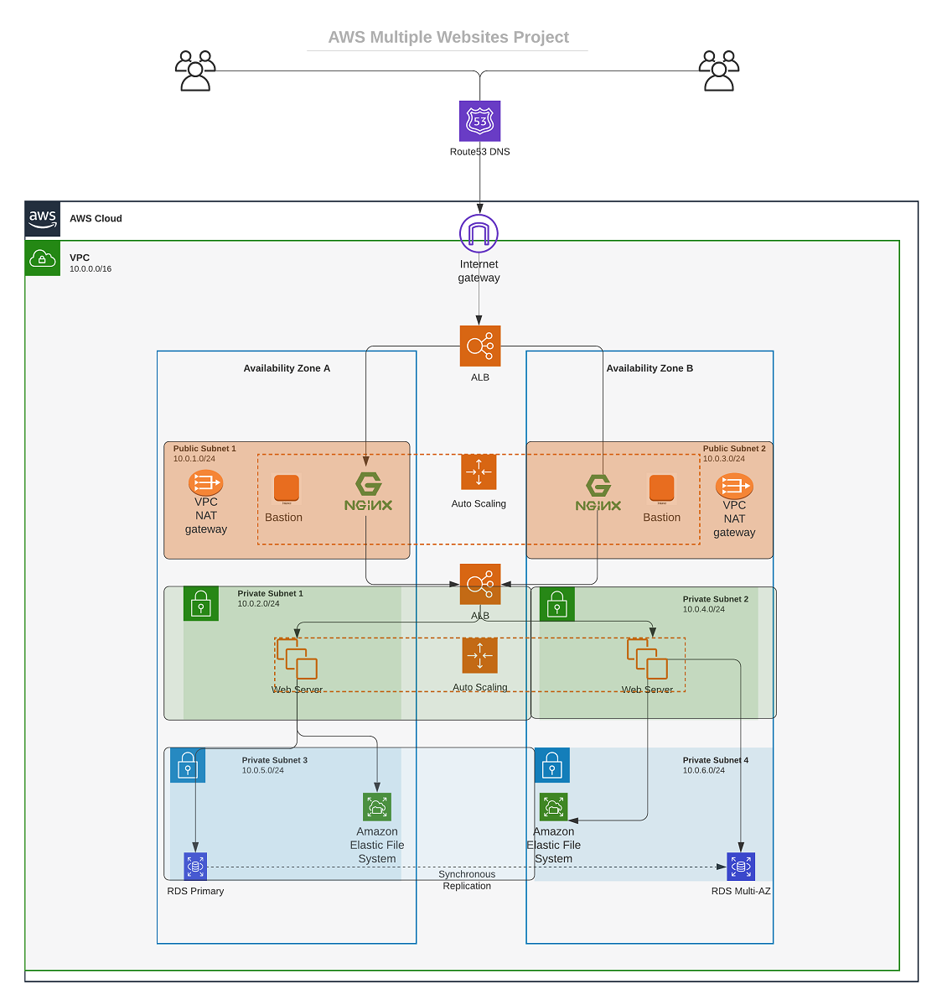

<!-- PROJECT LOGO -->
<br />
<div align="center">
  <a href="https://github.com/Adewalesemiloore/DevopsTask">
    
  </a>

<h3 align="center">AWS CLOUD SOLUTION FOR 2 COMPANY WEBSITES USING A REVERSE PROXY</h3>
  <p><b style="color: #fb6900">Maintainer:</b> <kbd>Adewale Oluwasemiloore</kbd> &nbsp; <b style="color: #fb6900">Date:</b> <kbd>November 26, 2026</kbd></p>
</div>

<p align="center">
  
  
  
  
  
  
  
  
  
</p>

---

## Project Overview

Until now I have used AWS mostly as a place to rent virtual machines (EC2, EBS, key pairs and basic security groups). The real power of the cloud goes well beyond that, and in this project I build a complete, secure network inside an **AWS VPC** for a fictitious company that runs two websites:

- a **WordPress** site for its main business, and
- a **Tooling website** for its DevOps team.

For better security and performance, both sites sit behind an **NGINX reverse proxy**. Cost, security and scalability are the key requirements, so the design must survive web server failures, absorb extra traffic, and stay reasonably cheap.

This project is done **manually through the AWS console** on purpose. Before automating infrastructure (which I start doing in Project 16 with Terraform), I need to understand each building block by hand, otherwise the automation becomes frustrating very quickly.



---

## Table of Contents

- [Architecture Overview](#architecture-overview)
- [Part 1 — AWS Account, Organization and Domain](#part-1--aws-account-organization-and-domain)
- [Part 2 — Set Up the VPC](#part-2--set-up-the-vpc)
- [Part 3 — Security Groups](#part-3--security-groups)
- [Part 4 — TLS Certificates with ACM](#part-4--tls-certificates-with-acm)
- [Part 5 — Configure EFS](#part-5--configure-efs)
- [Part 6 — Configure RDS](#part-6--configure-rds)
- [Part 7 — Target Groups and Load Balancers](#part-7--target-groups-and-load-balancers)
- [Part 8 — Build the AMIs](#part-8--build-the-amis)
- [Part 9 — Launch Templates](#part-9--launch-templates)
- [Part 10 — Auto Scaling Groups](#part-10--auto-scaling-groups)
- [Part 11 — Route 53 Records](#part-11--route-53-records)
- [Part 12 — Test the Websites](#part-12--test-the-websites)
- [Errors & Fixes](#errors--fixes)

---

## Architecture Overview

| Component | Purpose |
|---|---|
| Route 53 hosted zone | DNS for my registered domain |
| Internet Gateway + NAT Gateway | Public ingress and private subnet egress |
| Public ALB | Internet-facing entry point (HTTPS with an ACM certificate) |
| Nginx servers (ASG) | Reverse proxy in the public subnets |
| Bastion servers (ASG) | Single, restricted SSH entry point |
| Internal ALB | Receives traffic from Nginx and routes by host header |
| Webserver ASGs | WordPress and Tooling servers in private subnets |
| EFS | Shared file storage with one access point per website |
| RDS (Multi-AZ MySQL) | Highly available database in the data layer |
| KMS key | Encrypts the database storage |

Traffic flow: **Client → Route 53 → public ALB → Nginx → internal ALB → WordPress / Tooling webservers → RDS / EFS.**

---

## Part 1 — AWS Account, Organization and Domain

### 1.1 — Root account, sub-account and Organization Unit

I created an AWS root (master) account, then, inside it, a sub-account named **DevOps**.


Next I created an **Organization Unit (OU)** named **Dev** to hold development resources, and moved the DevOps account into it.


### 1.2 — Domain name and hosted zone

I registered an inexpensive domain at Namecheap, then created a **Route 53 hosted zone** for it and pointed the domain's name servers at the hosted zone.


---

## Part 2 — Set Up the VPC

### 2.1 — Create the VPC


### 2.2 — Enable DNS hostnames


### 2.3 — Internet Gateway

I created an internet gateway and attached it to the VPC.


### 2.4 — Subnets

Following the architecture, I created the subnets across two Availability Zones: public subnets, private subnets for the webservers, and private subnets for the data layer. A CIDR calculator helped me split the VPC range cleanly.


### 2.5 — Route tables

I created a public and a private route table and associated them with the matching subnets.


I then edited the public route table to send `0.0.0.0/0` to the Internet Gateway. This is what makes a public subnet reachable from the internet.


### 2.6 — Elastic IPs

I allocated 3 Elastic IPs: one for the NAT Gateway and two for the bastion hosts.


### 2.7 — NAT Gateway

I created the NAT Gateway in a public subnet and assigned one of the Elastic IPs to it, so private instances can reach the internet outbound.


---

## Part 3 — Security Groups

I created a separate security group for each tier, each allowing only the traffic that tier needs.


- **Application Load Balancer (public):** open to the internet.


- **Bastion servers:** SSH allowed only from my workstation's public IP.


- **Nginx servers:** access only from the public ALB.


- **Internal ALB:** access only from the Nginx servers.


- **Webservers:** access only from the internal ALB.


- **Data layer (RDS and EFS):** only webservers may connect to RDS, while both Nginx and webservers may reach the EFS mount points.


All the security groups together:


---

## Part 4 — TLS Certificates with ACM

The load balancers need TLS certificates for secure connectivity. In **AWS Certificate Manager (ACM)** I requested a public **wildcard certificate** for my domain.


I validated the domain with **DNS validation**, creating the CNAME record in Route 53.


---

## Part 5 — Configure EFS

I created an EFS file system with one mount target per AZ, placed in the two data-layer subnets and using the data-layer security group.


I then created **two access points**, one for WordPress and one for Tooling, so the two websites' files never overwrite each other when mounted.


---

## Part 6 — Configure RDS

### 6.1 — Create a KMS key

A KMS key is needed to encrypt the database.


For high availability and failover I used a **Multi-AZ RDS MySQL** deployment. With only 2 AZs I can fail over to one standby, but the concept is the same with 3.

### 6.2 — Create the DB subnet group

I created a subnet group containing the two private data-layer subnets.


### 6.3 — Create the database


---

## Part 7 — Target Groups and Load Balancers

### 7.1 — Target groups

I created target groups for Nginx, Tooling and WordPress. No instances are registered yet because they have not been launched. The Auto Scaling Groups will register them later.


### 7.2 — Public-facing and internal load balancers

First the public-facing ALB, with HTTPS using the ACM certificate and Nginx as the default target.


Then the internal ALB, with WordPress as the default target.


I added a listener rule that forwards traffic to the Tooling target group when the host header matches the tooling hostname.


---

## Part 8 — Build the AMIs

### 8.1 — Launch 4 RHEL 8 instances

I launched four RHEL 8 instances to become the Bastion, Nginx, WordPress and Tooling templates.


### 8.2 — Install base packages

Run on the bastion, Nginx, WordPress and Tooling servers:

```bash
sudo yum install -y https://dl.fedoraproject.org/pub/epel/epel-release-latest-8.noarch.rpm
sudo yum install -y dnf-utils http://rpms.remirepo.net/enterprise/remi-release-8.rpm
sudo yum install -y wget vim python3 telnet htop git mysql net-tools chrony
sudo systemctl start chronyd
sudo systemctl enable chronyd
```

### 8.3 — SELinux policies

For the webservers (Tooling, WordPress) and Nginx servers:

```bash
sudo setsebool -P httpd_can_network_connect 1
sudo setsebool -P httpd_can_network_connect_db 1
sudo setsebool -P httpd_execmem 1
sudo setsebool -P httpd_use_nfs 1
```

### 8.4 — Install Amazon EFS utils

```bash
sudo yum install -y git
git clone https://github.com/aws/efs-utils
cd efs-utils
sudo yum install -y make
sudo yum install -y go cmake rust cargo openssl-devel make rpm-build
make rpm
sudo yum install -y ./build/amazon-efs-utils*rpm
```

### 8.5 — Self-signed certificate for the Nginx instance

```bash
sudo mkdir -p /etc/ssl/private
sudo chmod 700 /etc/ssl/private
sudo openssl req -x509 -nodes -days 365 -newkey rsa:2048 \
-keyout /etc/ssl/private/<company>.key \
-out /etc/ssl/certs/<company>.crt
sudo openssl dhparam -out /etc/ssl/certs/dhparam.pem 2048
```


### 8.6 — Self-signed certificate for the Apache (Tooling) instance

```bash
sudo openssl req -newkey rsa:2048 -nodes \
-keyout /etc/pki/tls/private/<company>.key \
-x509 -days 365 \
-out /etc/pki/tls/certs/<company>.crt
sudo yum install -y httpd
sudo systemctl restart httpd
sudo systemctl enable httpd
sudo systemctl status httpd
sudo yum reinstall -y mod_ssl
sudo vim /etc/httpd/conf.d/ssl.conf
```

In `ssl.conf` I pointed the certificate and key directives at the files created above.


### 8.7 — Create AMIs from the instances


---

## Part 9 — Launch Templates

From the custom AMIs I created a launch template for each instance type.


The user data for each template comes from my configuration repo and is edited with my own details. For the database name, I connected from an instance to the RDS endpoint and created databases of my choice.


I tested connectivity to the RDS endpoint on port 3306, then created the databases:

```bash
nc -zv <rds-endpoint> 3306
mysql -h <rds-endpoint> -u admin -p
```

```sql
CREATE DATABASE toolingdb;
CREATE DATABASE wordpressdb;
SHOW DATABASES;
```


With those credentials in hand, I finished the launch template user data:


---

## Part 10 — Auto Scaling Groups

### 10.1 — Bastion


### 10.2 — Nginx


### 10.3 — WordPress and Tooling

I repeated the same process for WordPress and Tooling, selecting their respective target groups.


---

## Part 11 — Route 53 Records

I added alias records for `tooling.<your-domain>` and `wordpress.<your-domain>` pointing at the internet-facing load balancer.


> **Note:** While creating the records I pointed them at the public ALB instead of the internal ALB where I had already added the Tooling host-header rule. Rather than recreate the records, I chose to continue and learn from it: I created fresh target groups for the Tooling and WordPress pages on the public ALB.


Then I added host-header rules to the public ALB so each hostname is forwarded to the right target group.


---

## Part 12 — Test the Websites

Opening the Tooling site at first returned an error (see [Errors & Fixes](#errors--fixes) below for the full troubleshooting).


After the fixes, the site root answered through the load balancer (it still shows the default RHEL test page, since the tooling app has no index page at the root), and the application's login page loaded at `/login.php`:

```
https://tooling.<your-domain>
https://tooling.<your-domain>/login.php
```


---

## Errors & Fixes

### 504 Gateway Time-out on the Tooling and WordPress sites

**Symptom:** After the records and rules were in place, both `tooling.<your-domain>` and `wordpress.<your-domain>` returned **504 Gateway Time-out**. In the target group, the `tooling-tg` target showed as **Unhealthy**.


**Root cause:** Two problems stacked on each other. The webserver security group did not allow HTTP from the ALB security group, so health checks could not reach the server. Once that was fixed, Apache was running but answering `403 Forbidden` on `/` and `404` on `/login.php`, because the document root did not contain the tooling application (only a placeholder `index.html`, and the app files were not at the web root).

**Fix:**

1. Add an **HTTP** inbound rule to the webserver security group with the **ALB security group as source**.


2. SSH into the Tooling server and confirm Apache is active:

```bash
sudo systemctl status httpd
```


3. Check the response from the server itself. It returned 403 on `/` and 404 on `/login.php`:

```bash
curl -I http://localhost
curl -I http://localhost/login.php
```


4. Remove the placeholder `index.html`:

```bash
cd /var/www/html
ls -la
sudo rm -f /var/www/html/index.html
```


5. Clone the tooling repository into the web root and restart Apache:

```bash
cd /var/www/html
sudo git clone <tooling-repo-url> .
sudo systemctl restart httpd
```


If the clone nests the code inside an extra `html` folder, move its contents up and restart Apache:

```bash
sudo cp -r /var/www/html/html/* /var/www/html/
sudo cp -r /var/www/html/html/.[!.]* /var/www/html/ 2>/dev/null || true
sudo rm -rf /var/www/html/html
sudo systemctl restart httpd
curl -I http://localhost/
curl -I http://localhost/login.php
```


Once `login.php` returned `HTTP/1.1 200 OK`, I reloaded the Tooling site through the load balancer and the login page loaded.

### Records pointed at the wrong load balancer

**Symptom:** The Route 53 records targeted the public ALB while the Tooling host-header rule lived on the internal ALB.

**Root cause:** A selection mistake when creating the alias records.

**Fix:** Created new Tooling and WordPress target groups on the public ALB and added host-header rules there (Part 11).

---

*Project completed by **Adewale Oluwasemiloore***
