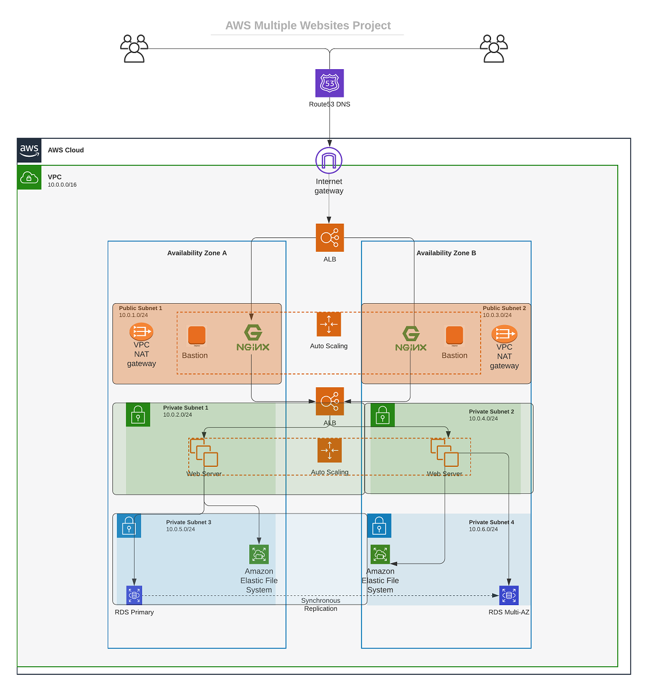

<!-- PROJECT LOGO -->
<br />
<div align="center">
  <a href="https://github.com/Adewalesemiloore/DevopsTask">
    
  </a>

<h3 align="center">AUTOMATE INFRASTRUCTURE WITH IAC USING TERRAFORM — PART 1</h3>
  <p><b style="color: #fb6900">Maintainer:</b> <kbd>Adewale Oluwasemiloore</kbd> &nbsp; <b style="color: #fb6900">Date:</b> <kbd>November 26, 2026</kbd></p>
</div>

<p align="center">
  
  
  
  
  
  
</p>

---

## Project Overview

In Project 15, I built a full AWS architecture by hand through the console. It worked, but clicking through a console is slow, hard to repeat and impossible to review. This project is where I start doing the same job as **Infrastructure as Code (IaC)** using **Terraform**, so the entire network can be created, changed and destroyed from a few text files.

In this first part I focus on the networking layer: a **VPC** and **public subnets**. I start with a deliberately simple, hard-coded configuration, then refactor it step by step using variables, data sources, `count`, and the `cidrsubnet()` and `length()` functions until nothing important is hard coded.



---

## Table of Contents

- [Prerequisites](#prerequisites)
- [Part 1 — IAM User and Programmatic Access](#part-1--iam-user-and-programmatic-access)
- [Part 2 — S3 Bucket for Terraform State](#part-2--s3-bucket-for-terraform-state)
- [Part 3 — Verify Access with boto3](#part-3--verify-access-with-boto3)
- [Part 4 — Install Terraform](#part-4--install-terraform)
- [Part 5 — Create the VPC](#part-5--create-the-vpc)
- [Part 6 — Create Subnets (Hard-Coded Version)](#part-6--create-subnets-hard-coded-version)
- [Part 7 — Refactor: Variables, Data Sources and Loops](#part-7--refactor-variables-data-sources-and-loops)
- [Part 8 — Split into variables.tf and terraform.tfvars](#part-8--split-into-variablestf-and-terraformtfvars)
- [Part 9 — Final Plan and Apply](#part-9--final-plan-and-apply)
- [Errors & Fixes](#errors--fixes)

---

## Prerequisites

Terraform terminology I needed to be comfortable with: attribute, resource, interpolation, argument, provider, provisioner, input/output variable, module, data source, local value and backend. Data types (string, integer, float, boolean) also matter because variables are typed.

Best practices followed throughout:

- Tag every resource with multiple key-value pairs.
- Write reusable code and avoid hard coding. I start hard coded for learning, then refactor.

---

## Part 1 — IAM User and Programmatic Access

### 1.1 — Create the `terraform` IAM user

I created an IAM user named `terraform` with **programmatic access only** and attached the **AdministratorAccess** policy.


I saved the access key ID and secret access key temporarily. These are credentials, so they must never be committed to a repo.


### 1.2 — Configure the workstation

I used Python 3.6+ with the AWS SDK (`boto3`) and the AWS CLI for authentication.


```bash
pip install boto3
```


Then configured the CLI credentials:

```bash
aws configure
# AWS Access Key ID:     <your-access-key-id>
# AWS Secret Access Key: <your-secret-access-key>
# Default region name:   us-east-1
```


---

## Part 2 — S3 Bucket for Terraform State

I created an S3 bucket to hold the Terraform state file, named like `<yourname>-dev-terraform-bucket`. It will be used from Project 17 onwards.


> **Note:** S3 bucket names must be globally unique within a region partition, so pick something specific to you.

---

## Part 3 — Verify Access with boto3

Before touching Terraform, I confirmed that my machine can programmatically reach my AWS account by listing buckets:

```python
import boto3
s3 = boto3.resource('s3')
for bucket in s3.buckets.all():
    print(bucket.name)
```


---

## Part 4 — Install Terraform

On Windows I installed Terraform from an admin PowerShell (Chocolatey must already be installed):

```powershell
choco install terraform
# or
winget install Hashicorp.Terraform
```


---

## Part 5 — Create the VPC

I created a folder called `PBL` in VS Code, and inside it a `main.tf`. The `provider` block tells Terraform we are building in AWS, and the `resource` block creates the VPC.

```hcl
provider "aws" {
  region = "us-east-1"
}

# Create VPC
resource "aws_vpc" "main" {
  cidr_block           = "172.16.0.0/16"
  enable_dns_support   = "true"
  enable_dns_hostnames = "true"
}
```

> **Note:** You can use a region closer to you; the same applies to every snippet below.

### 5.1 — Initialise

`terraform init` downloads the plugin for the AWS provider.

```bash
terraform init
```


### 5.2 — Plan and apply

I always check what Terraform intends to do before letting it do it.

```bash
terraform plan
terraform apply
```


---

## Part 6 — Create Subnets (Hard-Coded Version)

The architecture needs 6 subnets: 2 public, 2 private for web servers and 2 private for the data layer. I started with the two public subnets, one resource block each.

```hcl
# Create public subnet1
resource "aws_subnet" "public1" {
  vpc_id                  = aws_vpc.main.id
  cidr_block              = "172.16.0.0/24"
  map_public_ip_on_launch = true
  availability_zone       = "us-east-1a"
}

# Create public subnet2
resource "aws_subnet" "public2" {
  vpc_id                  = aws_vpc.main.id
  cidr_block              = "172.16.1.0/24"
  map_public_ip_on_launch = true
  availability_zone       = "us-east-1b"
}
```


`vpc_id = aws_vpc.main.id` interpolates the VPC id so Terraform knows which VPC to place each subnet in.

```bash
terraform plan
terraform apply
```


### Observations

- **Hard-coded values:** both `availability_zone` and `cidr_block` are fixed.
- **Repeated resource blocks:** one block per subnet gets clumsy fast (imagine 10 subnets). A single block with `count` is the right approach.

Since this is a development environment, I destroyed everything before refactoring. (Never do this to production infrastructure.)

```bash
terraform destroy
```


---

## Part 7 — Refactor: Variables, Data Sources and Loops

### 7.1 — Remove hard-coded values with variables

```hcl
variable "region" {
  default = "us-east-1"
}

variable "vpc_cidr" {
  default = "172.16.0.0/16"
}

variable "enable_dns_support" {
  default = "true"
}

variable "enable_dns_hostnames" {
  default = "true"
}

provider "aws" {
  region = var.region
}

# Create VPC
resource "aws_vpc" "main" {
  cidr_block           = var.vpc_cidr
  enable_dns_support   = var.enable_dns_support
  enable_dns_hostnames = var.enable_dns_support
}
```


### 7.2 — Fetch availability zones with a data source

Regions have between 2 and 4 AZs, so hard coding names is fragile. A **data source** pulls the list straight from AWS:

```hcl
# Get list of availability zones
data "aws_availability_zones" "available" {
  state = "available"
}
```

### 7.3 — Use `count` and `cidrsubnet()`

```hcl
resource "aws_subnet" "public" {
  count                   = 2
  vpc_id                  = aws_vpc.main.id
  cidr_block              = cidrsubnet(var.vpc_cidr, 4, count.index)
  map_public_ip_on_launch = true
  availability_zone       = data.aws_availability_zones.available.names[count.index]
}
```

`count` alone is not enough: the same CIDR cannot be created twice in one VPC, so `cidrsubnet(prefix, newbits, netnum)` generates a unique CIDR per iteration:

- `prefix`: the base range in CIDR notation (the VPC CIDR).
- `newbits`: bits added to the prefix. A `/16` with `newbits = 4` becomes `/20`.
- `netnum`: a whole number (fits in `newbits` bits) that fills the new bits.

I experimented in the Terraform console:

```bash
terraform console
> cidrsubnet("172.16.0.0/16", 4, 0)
> exit
```


### 7.4 — Remove the hard-coded count with `length()`

```hcl
count = length(data.aws_availability_zones.available.names)
```

This returns the number of AZs in the region (for example 3), but the requirement is only 2 public subnets. So I added a variable for the preferred number:

```hcl
variable "preferred_number_of_public_subnets" {
  default = 2
}
```


And used a conditional expression: if the variable is `null`, use the number of AZs, otherwise use the variable.

```hcl
resource "aws_subnet" "public" {
  count                   = var.preferred_number_of_public_subnets == null ? length(data.aws_availability_zones.available.names) : var.preferred_number_of_public_subnets
  vpc_id                  = aws_vpc.main.id
  cidr_block              = cidrsubnet(var.vpc_cidr, 4, count.index)
  map_public_ip_on_launch = true
  availability_zone       = data.aws_availability_zones.available.names[count.index]
}
```

Reading it as `condition ? value_if_true : value_if_false`:

1. `var.preferred_number_of_public_subnets == null` checks whether a preference was set.
2. If true, use `length(...)` (all AZs).
3. If false, use the preferred number.

---

## Part 8 — Split into variables.tf and terraform.tfvars

To keep `main.tf` readable, I moved variable declarations into `variables.tf` and the actual values into `terraform.tfvars`.

### main.tf

```hcl
# Get list of availability zones
data "aws_availability_zones" "available" {
  state = "available"
}

provider "aws" {
  region = var.region
}

# Create VPC
resource "aws_vpc" "main" {
  cidr_block           = var.vpc_cidr
  enable_dns_support   = var.enable_dns_support
  enable_dns_hostnames = var.enable_dns_support
}

# Create public subnets
resource "aws_subnet" "public" {
  count                   = var.preferred_number_of_public_subnets == null ? length(data.aws_availability_zones.available.names) : var.preferred_number_of_public_subnets
  vpc_id                  = aws_vpc.main.id
  cidr_block              = cidrsubnet(var.vpc_cidr, 4, count.index)
  map_public_ip_on_launch = true
  availability_zone       = data.aws_availability_zones.available.names[count.index]
}
```

### variables.tf

```hcl
variable "region" {
  default = "us-east-1"
}

variable "vpc_cidr" {
  default = "172.16.0.0/16"
}

variable "enable_dns_support" {
  default = "true"
}

variable "enable_dns_hostnames" {
  default = "true"
}

variable "preferred_number_of_public_subnets" {
  default = null
}
```

### terraform.tfvars

```hcl
region = "us-east-1"

vpc_cidr = "172.16.0.0/16"

enable_dns_support = "true"

enable_dns_hostnames = "true"

preferred_number_of_public_subnets = 2
```

The `PBL` folder now looks like this:

```
└── PBL
    ├── main.tf
    ├── terraform.tfstate
    ├── terraform.tfstate.backup
    ├── terraform.tfvars
    └── variables.tf
```


---

## Part 9 — Final Plan and Apply

I ran `terraform plan` and hit a provider error (covered in [Errors & Fixes](#errors--fixes)).


After fixing it and re-running `terraform init`, plan and apply succeeded.


```bash
terraform plan
terraform apply
```


The VPC and two public subnets, with dynamic CIDRs and AZs, are now created entirely from code.

---

## Errors & Fixes

### Provider package missing from `.terraform` cache

**Symptom:** `terraform validate` failed with: `there is no package for registry.terraform.io/hashicorp/aws 6.41.0 cached in .terraform\providers`.

**Root cause:** The cached provider in the `.terraform` directory did not match or was incomplete relative to the lock file, so Terraform could not use it.

**Fix:** Delete the cached provider directory and lock file, then initialise again:

```powershell
Remove-Item -Recurse -Force .terraform
Remove-Item -Force .terraform.lock.hcl
terraform init
```

After `terraform init` re-downloaded the provider, `terraform plan` and `terraform apply` worked.

---

*Project completed by **Adewale Oluwasemiloore***
